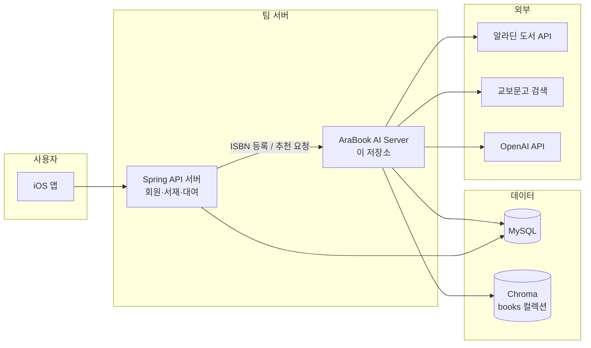
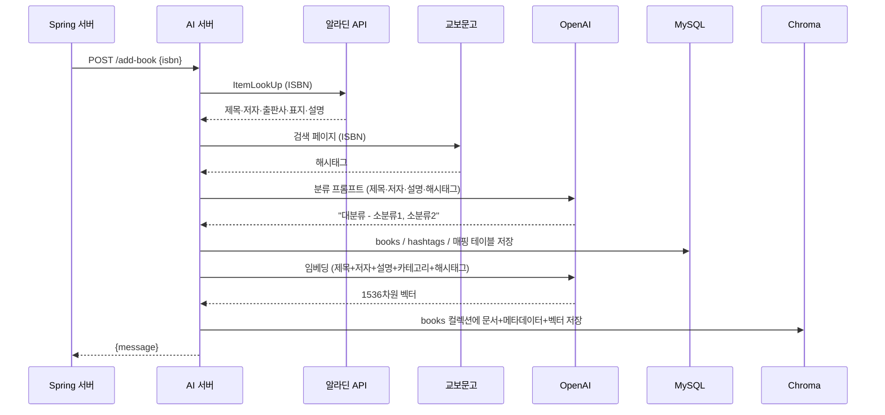

# AraBook AI Server

> 사용자가 고른 관심 분야를 바탕으로 **매일 책 1권을 추천**하는 독서 앱, AraBook의 AI 서버입니다.
> ISBN 하나로 도서 메타데이터·해시태그·카테고리를 모아 MySQL과 벡터 DB(Chroma)에 저장하고,
> 사용자의 취향과 가장 가까운 책을 골라 추천합니다.

- Python 3.10 · FastAPI · OpenAI · Chroma · MySQL
- API 7개 + 헬스체크 1개
- 테스트 166개 (외부 API/DB 없이 실행, CI 포함)

---

## 1. 무엇을 하는 서버인가

AraBook은 사용자가 회원가입할 때 관심 서브카테고리(예: `추리/스릴러`, `SF`, `과학 매거진`)를
고르면, 그 취향에 맞는 책을 하루 1권 추천합니다.

이 저장소는 앱과 DB 사이에서 **"책을 이해하는"** 일을 맡습니다.

| 하는 일 | 왜 필요한가 |
|---|---|
| ISBN → 도서 메타데이터 수집 (알라딘) | 앱에는 ISBN만 들어오고, 화면에 보여줄 제목·저자·표지·설명이 필요하다 |
| 해시태그 수집 (교보문고 검색) | 카테고리 분류의 근거를 늘린다 |
| LLM 카테고리 분류 (대분류 1 + 소분류 N) | 신간마다 사람이 분류하지 않아도 카탈로그가 쌓이게 한다 |
| MySQL + Chroma 이중 저장 | 관계형 조회(서점/관리 화면)와 의미 기반 추천을 동시에 하기 위해 |
| 취향 기반 추천 | 사용자가 고른 서브카테고리와 책을 같은 벡터 공간에서 비교한다 |
| 주기 작업 | 매일 전체 회원 추천 생성, 매월 베스트셀러 카탈로그 갱신 |

### 전체 구조에서의 위치



앱은 Spring 서버와 통신하고, Spring 서버가 이 AI 서버의 API를 호출합니다.
그래서 **API 경로와 응답 형태는 하위 호환이 필수**입니다(요청 필드 이름·camelCase 응답 키 유지).

---

## 2. 데이터 흐름

### (A) 도서 적재 — `POST /add-book`



### (B) 추천 — `POST /recommend`

1. `member_sub_category_selections`에서 회원이 고른 서브카테고리 이름을 읽습니다.
2. 그 이름들을 공백으로 이어 붙인 문자열을 임베딩합니다. (예: `"추리/스릴러 SF"`)
3. Chroma `books` 컬렉션에서 가까운 **후보 20권**(`n_results=20`)을 거리·임베딩과 함께 가져옵니다.
4. 후보를 **하이브리드 재정렬**합니다(`app/services/reranking.py`).
   - 관련도 = 코사인 유사도 + `0.15` × 선호 서브카테고리 일치율
   - 다양성 = MMR: `0.85 × 관련도 − 0.15 × max(이미 뽑힌 책과의 서브카테고리 Jaccard)`
5. 1순위의 ISBN으로 MySQL `books`에서 `book_id`를 얻고, `daily_book_id_recommendations`에
   **다음 날 날짜**로 저장합니다.
6. `{"message": "Recommended book ID: 42"}` 형태로 응답합니다.

> 왜 1위를 바로 쓰지 않는가: 카탈로그 진단에서 책끼리의 최근접 코사인 유사도가
> **0.839~0.931**에 몰려 있었습니다. 상위 후보의 벡터 점수 차이가 0.01~0.05 수준이라,
> 벡터 순위만으로는 선호 카테고리 신호가 거의 반영되지 않습니다. 그래서 카테고리
> 일치율을 더하고, 같은 카테고리 후보가 반복 선택되는 것을 MMR로 눌러 줍니다.
> 가중치는 평가셋으로 튜닝한 값이 아니라 **사전에 고정한 값**입니다(아래 7절).

> 재정렬은 후보 목록 전체의 순위를 만듭니다. `/recommend`는 "하루 1권"이라 그중 1권만
> 응답하므로 다양성 항은 2순위 이하에서만 드러납니다. 같은 함수를 평가 하네스가
> `production_hybrid` 변형으로 그대로 불러, 순위 전체에 대한 효과를 재도록 했습니다.

상위 k권이 필요하면 `RecommendationService.rank(member_id, limit)`을 쓰면 됩니다
(현재 API 응답 스키마는 바꾸지 않았습니다).

---

## 3. API

| 메서드 | 경로 | 요청 | 응답 | 설명 |
|---|---|---|---|---|
| POST | `/generate` | `{prompt, model="gpt-4", max_tokens=100}` | `{generated_text}` | 프롬프트로 텍스트 생성 |
| POST | `/classify` | `{title, author, isbn, description}` | `{title, main_category, sub_category[]}` | 도서 카테고리 분류 (내부에서 해시태그 수집) |
| POST | `/crawl` | `{isbn, max_tokens=100}` | `{isbn, hashtags[]}` | 교보문고 해시태그 수집 |
| POST | `/add-book` | `{isbn}` | `{message}` | 조회·분류·저장 파이프라인 전체 실행 |
| POST | `/delete-book` | `{isbn}` | `{message}` | Chroma에서 도서 삭제 |
| GET | `/get-book?isbn=...` | 쿼리 파라미터 | `{title, author, isbn, description, hashtags, mainCategory, subCategory}` | Chroma에서 도서 조회 |
| POST | `/recommend` | `{member_id}` | `{message}` | 회원 취향 기반 추천 |
| GET | `/health` | – | `{status: "ok"}` | 배포/모니터링용 헬스체크 (추가된 엔드포인트) |

`/get-book`의 `hashtags`, `subCategory`는 **쉼표로 구분된 문자열**입니다(기존 응답 형태 유지).
`/delete-book`은 없는 책이어도 기존과 같이 `200`과 `"존재하지 않는 책 정보입니다."`를 반환합니다.
`/recommend`의 요청·응답과 메시지 문자열(`No preferences found for the member.` 등)도
기존과 같습니다. 내부 추천 알고리즘만 바뀌었습니다(요청/응답 스키마 변경 없음).

### 에러 응답

모든 에러는 `{"detail": "사람이 읽을 수 있는 메시지"}` 형태입니다(FastAPI 기본 형태 유지).

| 상태 코드 | 언제 | 예시 |
|---|---|---|
| 404 | 알라딘에서 책을 못 찾음, Chroma에 없는 ISBN 조회 | `존재하지 않는 책 정보입니다.` |
| 422 | 요청 필드 누락/빈 값 (Pydantic 검증) | `prompt`가 빈 문자열 |
| 502 | 알라딘·교보·OpenAI 호출 실패, LLM 응답 형식 오류 | `OpenAI 텍스트 생성에 실패했습니다: ...` |
| 503 | MySQL/Chroma 사용 불가 | `데이터베이스에 연결하지 못했습니다: ...` |
| 500 | 예상하지 못한 오류 (내부 문자열은 응답에 노출하지 않고 로그에만 남김) | `서버 내부 오류가 발생했습니다.` |

### 예시

```bash
curl -X POST http://localhost:8000/add-book \
  -H "Content-Type: application/json" -d '{"isbn": "9791131963746"}'
# {"message": "책 정보가 성공적으로 추가되었습니다."}

curl -X POST http://localhost:8000/recommend \
  -H "Content-Type: application/json" -d '{"member_id": 1}'
# {"message": "Recommended book ID: 42"}
```

서버를 띄우면 `http://localhost:8000/docs`에서 Swagger UI로 바로 호출해 볼 수 있습니다.

---

## 4. 기술 스택과 선택 이유

| 기술 | 쓰는 곳 | 선택 이유 |
|---|---|---|
| **FastAPI** | API | async 지원(외부 API를 여러 개 부르는 파이프라인), Pydantic 검증, OpenAPI 문서 자동 생성 |
| **Pydantic v2** | 요청/응답 스키마 | 필드 검증을 선언적으로. 잘못된 입력이 500이 아니라 422로 떨어짐 |
| **OpenAI (AsyncOpenAI)** | 카테고리 분류, 임베딩, 텍스트 생성 | 분류 규칙을 프롬프트로 관리할 수 있고, 임베딩으로 취향-도서 유사도를 계산 |
| **Chroma** | 벡터 저장소 | 별도 서버 없이 파일 기반으로 동작(`chroma_db/`). 팀 규모에서 인프라 부담이 가장 적음 |
| **MySQL** | 도서·회원·대여·추천 이력 | Spring 서버가 이미 쓰는 스키마와 같은 DB를 공유해야 함 |
| **SSH 터널 (sshtunnel)** | MySQL 접속 | DB를 공인망에 열지 않기 위해. 접속 정보는 환경 변수로만 |
| **APScheduler** | 주기 작업 | 별도 큐/워커 없이 앱 안에서 cron 작업 2개를 돌리기에 충분 |
| **Docker** | 배포 | 기존 팀 배포 흐름(Docker Hub 이미지) 유지 |
| **pytest + httpx** | 테스트 | `TestClient`로 실제 라우팅·검증·에러 핸들러까지 확인 |
| **ruff** | 린트 | 문법 오류(F)와 미사용 import(E9)만 엄격히 — 스타일 논쟁 없이 실수만 잡음 |

임베딩 모델은 `text-embedding-ada-002`를 그대로 씁니다. 기존 카탈로그가 이 모델로
만들어져 있어, 모델을 바꾸면 **저장된 벡터와 호환되지 않습니다**(재색인이 필요).

---

## 5. 로컬 실행

### 준비물
- Python 3.10+
- OpenAI API 키 (분류/임베딩/생성에 필요)
- 알라딘 TTB 키 (도서 조회/베스트셀러)
- MySQL 접속 정보 (SSH 터널) — 추천·저장 기능을 쓸 때
- (선택) `chroma_db/` — 없으면 빈 컬렉션으로 시작하고 `/add-book`으로 채웁니다

```bash
git clone https://github.com/TeamAraBook/AraBook-AI-Server.git
cd AraBook-AI-Server

python -m venv .venv
source .venv/bin/activate
pip install -r requirements-dev.txt      # 런타임 + 테스트 도구

cp .env.example .env                     # 값을 채워 넣기
uvicorn app.main:app --reload            # http://127.0.0.1:8000/docs
```

> `uvicorn main:app`도 계속 동작합니다(하위 호환 shim). 새 코드는 `app.main:app`을 씁니다.

### 테스트

```bash
pytest                                   # 166 passed
ruff check app eval scripts tests main.py --select F,E9
```

테스트는 OpenAI·Chroma·MySQL·크롤링을 모두 가짜 객체로 대체하므로 **API 키도 DB도 필요 없습니다**
(`app.deps`의 `dependency_overrides` 사용). CI(`.github/workflows/tests.yml`)도 secrets 없이 돕니다.

### Docker

```bash
docker build -t arabookai .
docker run --env-file .env -p 8000:8000 -v $(pwd)/chroma_db:/app/chroma_db arabookai
```

`chroma_db/`는 git에 포함되지 않으므로, 컨테이너에서는 **볼륨으로 마운트**해 데이터를 유지합니다.

### 환경 변수

| 변수 | 필수 | 의미 |
|---|---|---|
| `OPENAI_API_KEY` | O | LLM 분류/생성·임베딩 |
| `OPENAI_CHAT_MODEL` | – | 기본 `gpt-4` |
| `OPENAI_EMBEDDING_MODEL` | – | 기본 `text-embedding-ada-002` (기존 벡터와 호환되는 값) |
| `ALADIN_TTBKEY` | O | 알라딘 도서 조회/베스트셀러 |
| `CHROMA_PERSIST_DIRECTORY` | – | 기본 `./chroma_db` |
| `CHROMA_COLLECTION_NAME` | – | 기본 `books` |
| `CATEGORIES_PATH` | – | 해시태그에서 제외할 표준 카테고리 목록, 기본 `categories.txt` |
| `HTTP_TIMEOUT_SECONDS` | – | 외부 HTTP 타임아웃, 기본 10 |
| `SCHEDULER_ENABLED` | – | 기본 `true`. 워커가 2개 이상이면 `false`로 두고 한 곳에서만 켜기 |
| `LOG_LEVEL` | – | 기본 `INFO` |
| `RECOMMEND_POOL_SIZE` | – | 재정렬할 후보 수, 기본 `20` |
| `RECOMMEND_CATEGORY_WEIGHT` | – | 카테고리 일치율 가중치, 기본 `0.15` |
| `RECOMMEND_MMR_LAMBDA` | – | MMR lambda(1이면 다양성 항 끔), 기본 `0.85` |
| `SSH_TUNNEL_HOST_ADDRESS` / `SSH_TUNNEL_HOST_PORT` | O(DB) | DB 접속용 SSH 점프 호스트 |
| `SSH_USERNAME` / `SSH_PRIVATE_KEY` | O(DB) | SSH 사용자/개인 키 경로 |
| `MYSQL_SERVER_HOST` | O(DB) | 터널 너머 MySQL 호스트 |
| `DB_USERNAME` / `DB_PASSWORD` / `DB_DATABASE_NAME` | O(DB) | MySQL 계정/스키마 |

---

## 6. 디렉터리 구조

```
.
├── app/
│   ├── main.py              # 앱 조립, lifespan(스케줄러), 라우터 등록
│   ├── deps.py              # 의존성 주입 (테스트에서 통째로 교체 가능)
│   ├── schemas.py           # 요청/응답 Pydantic 모델
│   ├── domain.py            # Book, BestSeller
│   ├── core/
│   │   ├── config.py        # 환경 변수 → Settings
│   │   ├── errors.py        # 도메인 예외 + HTTP 매핑
│   │   └── logging.py
│   ├── routers/             # generate, classify, crawl, books, recommend, health
│   └── services/
│       ├── aladin.py        # 알라딘 도서 API
│       ├── kyobo.py         # 교보문고 해시태그 수집
│       ├── classifier.py    # LLM 카테고리 분류 (프롬프트/파싱)
│       ├── llm.py           # OpenAI 텍스트 생성·임베딩
│       ├── database.py      # MySQL (SSH 터널)
│       ├── vector_store.py  # Chroma
│       ├── recommendation.py# 추천 로직 조합
│       ├── library.py       # 적재 파이프라인
│       └── scheduler.py     # 주기 작업
├── eval/                    # 추천 품질 오프라인 평가 (지표·하네스·리포트)
├── scripts/
│   ├── eval_recommend.py    # 평가 실행 CLI
│   ├── export_labels.py     # MySQL 행동 로그 → eval/labels.json (라벨 추출)
│   ├── clean_catalog.py     # 카탈로그 메타데이터 점검·정규화 (기본 dry-run)
│   ├── catalog_stats.py     # 카탈로그 통계 (읽기 전용)
│   └── catalog_diagnostics.py # 임베딩 공간 진단 (읽기 전용)
├── tests/                   # pytest (API 22, 서비스 32, 재정렬 29, 평가 지표 27,
│                            #  평가 하네스 10, 진단 3, 라벨 추출 24, 카탈로그 정제 19 = 166)
├── categories.txt           # 표준 카테고리 사전 (해시태그 필터)
├── main.py                  # 하위 호환 shim (`uvicorn main:app`)
├── requirements.txt         # 런타임 직접 의존성
├── requirements-dev.txt     # + pytest/httpx/ruff
├── requirements-lock.txt    # 과거 pip freeze (환경 재현용)
├── Dockerfile
└── .env.example
```

---

## 7. 추천 품질은 어떻게 검증하는가

"추천이 좋아졌다"를 말하려면 근거가 있어야 합니다. 이 저장소에는 **오프라인 평가 하네스**가
들어 있습니다. 자세한 설계는 [`eval/README.md`](eval/README.md), 실행 결과는
[`eval/results.md`](eval/results.md)에 있습니다.

### 지표와 선택 이유

| 지표 | 정의 | 왜 이 지표인가 |
|---|---|---|
| Recall@k | top-k 중 정답 비율 / 전체 정답 수 | 읽을 만한 책을 놓치지 않는가 |
| Precision@k | top-k 중 정답 비율 / k | 추천한 것이 얼마나 맞는가 |
| MRR | 첫 정답의 역순위 | 하루 1권 서비스라 **첫 순위**가 사용자 경험을 좌우 |
| nDCG@k | 등급 라벨 기반 순위 품질 | "매우 관련"을 위에 놓았는가 (등급 라벨이 있을 때) |
| Coverage@k | 모든 사용자의 top-k 합집합 / 카탈로그 | 특정 책만 반복 추천되는가 |
| 다양성 | top-k 서브카테고리 분포의 정규화 엔트로피 | 한 장르에 몰리는가 |

k는 1·3·5·10을 씁니다.

### 비교 대상 (이전 운영 + 개선 후보 3개)

| variant | 내용 | 상태 |
|---|---|---|
| `baseline_vector` | **이전** 운영 로직: 선호 텍스트 임베딩 → L2 최근접 | 비교 기준(과거) |
| `category_filter` | 선호 서브카테고리와 겹치는 책만 후보 → 벡터 정렬 | 가설 |
| `hybrid_category_boost` | `cosine + 0.15 × 카테고리 일치율` | 가설 |
| `production_hybrid` | **현재** 운영 로직: 코사인 + 카테고리 가중 + MMR 다양성 | 현행(운영 코드와 같은 함수) |

`production_hybrid`는 운영 코드(`app/services/reranking.py`)를 그대로 import해 순위를
만듭니다. 평가용으로 다시 구현하지 않았기 때문에, 오프라인 순위와 배포 순위가
같은 규칙임을 보장합니다.

`alpha=0.15`와 `lambda=0.85`는 평가셋으로 튜닝한 값이 아니라 **사전에 고정한 값**입니다. 평가셋으로
튜닝하면 그 평가셋에서만 좋아져 비교가 무의미해지기 때문에, 튜닝은 별도 dev split에서
해야 한다는 것을 코드와 리포트에 명시했습니다.

### 데이터를 어떻게 만들 것인가

라벨 형식은 [`eval/labels.schema.json`](eval/labels.schema.json)에 정의되어 있고, 예시는
[`eval/labels.example.json`](eval/labels.example.json)입니다.

```json
{
  "meta": { "format_version": 1, "label_source": "mysql-loans-2026-09..11" },
  "users": [
    { "member_id": 1001, "preferences": ["추리/스릴러"], "relevant_isbns": ["9791131963746"] }
  ]
}
```

실제 라벨은 MySQL의 양성 행동(대여·구매·좋아요·서재 추가)에서 만듭니다.
`python scripts/export_labels.py`가 이 일을 합니다(바로 아래 "라벨 만들기" 참고).
이때 **노출 편향**을 피해야 합니다. 추천으로 노출된 책만 정답으로 쓰면 "추천기가 추천한 책을
추천기가 맞혔다"는 순환이 되므로, 사용자가 스스로 찾아 읽은 책을 포함하는 방식으로
모으는 것을 원칙으로 했습니다. 스크립트의 `--exclude-recommended`가 노출 이력
(`daily_book_id_recommendations`)에 있는 책을 정답에서 빼는 역할을 합니다.

### 라벨 만들기 — `scripts/export_labels.py`

행동 테이블 이름·컬럼은 이 저장소에 없으므로 **인자로 받습니다**(잘못된 이름이면
조용히 0건이 아니라 SQL 오류로 바로 드러납니다).

```bash
python scripts/export_labels.py \
  --since 2026-09-01 --until 2026-12-01 \
  --action "table=rentals,member=member_id,book=book_id,time=rented_at,weight=2" \
  --action "table=book_likes,member=member_id,book=book_id,time=created_at,weight=1" \
  --exclude-recommended --out eval/labels.json
```

- `book=`은 `book_id`(→ `books` 조인), `isbn=`은 ISBN을 직접 든 컬럼입니다.
- 결과는 실행 시 `eval/labels.schema.json`으로 검증하고, 통과해야 파일을 씁니다.
- 사용자별 정답 수·카탈로그 밖 ISBN 제거 건수 같은 요약을 함께 출력합니다.
- `eval/labels.json`은 실제 사용자 데이터라 `.gitignore`에 넣었습니다(커밋 금지).

### 현재 상태: 수치 미산출

이 작업 환경에서는 운영 DB(`eval/labels.json`)에 접근할 수 없어 **라벨을 실제로
추출하지는 못했습니다.** 예시 라벨은 형식 예시(합성)이고, 하네스는
`label_source`가 `example`/`synthetic`이면 측정을 거부합니다(합성 수치가 커밋되는 것을
막기 위한 장치). 그래서 `eval/results.md`에는 사유와 함께 **"수치 미산출"**로 기록되어
있고, 표를 0으로 채우지 않았습니다.

측정은 다음 한 줄로 실행합니다.

```bash
python scripts/eval_recommend.py --labels eval/labels.json   # OPENAI_API_KEY 필요
```

### 지금 확인할 수 있는 사실 — 카탈로그 실측

측정은 못 해도, **무엇을 평가하려는지**는 셀 수 있습니다.
`python scripts/catalog_stats.py --db chroma_db` 실행 결과(2026-11-26, 읽기 전용):

| 항목 | 값 |
|---|---|
| 도서 수 | 30권 |
| 임베딩 차원 | 1536 (ada-002, 단위 벡터) |
| 대분류 라벨 | 8종 — 소설 12, 과학 7, 인문 3, `소설, 역사` 2, 자기계발 2, 시/에세이 2, `자기계발, 사회` 1, 역사 1 |
| 서브카테고리 라벨 | 32종 |
| 해시태그 | 113종 |
| 책당 평균 서브카테고리 | 2.1개 |

이 수치는 "정확도"가 아니라 **평가의 한계**를 보여줍니다. 30권은 Recall@10이 카탈로그의
1/3을 반환하는 크기라 지표가 쉽게 포화됩니다. 그래서 지표 구현은 합성 카탈로그로 단위
테스트(손 계산 값)해 두고, 실제 수치는 카탈로그가 수백 권 이상 쌓인 뒤 측정하는 것을
전제로 했습니다.

### 라벨 없이 지금 할 수 있는 점검 — 임베딩 공간 진단

정답 라벨이 없어도, 지금 저장된 벡터로 "카테고리가 벡터 공간에서 뭉쳐 있는가"는 볼 수
있습니다. `python scripts/catalog_diagnostics.py --db chroma_db` 실행 결과(2026-11-26):

| 항목 | 값 |
|---|---|
| 최근접 1권이 서브카테고리를 공유 | 17/30 (56.7%) |
| 같은 카테고리일 우연 기대값 | 14.7% |
| lift (관측 / 우연) | 3.85× |
| 상위 5권 중 하나라도 공유 | 26/30 (86.7%) |
| 최근접 이웃 유사도 (최소/중앙/최대) | 0.839 / 0.865 / 0.931 |

**이것은 정확도가 아닙니다.** 책 벡터에는 카테고리·해시태그가 이미 포함되어 있어
이웃이 같은 카테고리인 것은 부분적으로 당연하고, 실제 질의는 서브카테고리 이름만
임베딩한 짧은 문자열이라 조건이 다릅니다. 읽는 법은 두 가지입니다.

- 카테고리 신호가 벡터에 실려 있다(lift 3.85×) → 현재 임베딩 텍스트 구성이 완전히
  무의미하지는 않다는 근거.
- 최근접 이웃 유사도가 0.84~0.93에 몰려 있다 → ada-002에서 책끼리 유사도가 전반적으로
  높아 **순위 변별력이 크지 않을 수 있다**는 신호. 변별력은 라벨이 있는 평가에서 확인해야 합니다.
- 카테고리가 전혀 다른 최근접 이웃 13권은 `eval/catalog_diagnostics.md`에 ISBN과 함께 남겼습니다.

### 라벨 없이 지금 할 수 있는 정비 — 카탈로그 정제

`python scripts/clean_catalog.py --db chroma_db`는 메타데이터 결함을 **고치기 전에**
무엇이 어떻게 바뀔지 보여 줍니다(기본 dry-run). 위 통계의 `소설, 역사` 같은 다중
대분류는 3권에서 나왔고, 첫 값만 남기는 것을 제안합니다.

```bash
python scripts/clean_catalog.py --db chroma_db                       # 리포트만
python scripts/clean_catalog.py --db chroma_db --apply --out-db chroma_db_clean
```

- 원본 `chroma_db/`는 읽기조차 임시 사본으로 한다(Chroma가 폴더를 열며 파일을 쓸 수 있음).
- `--apply`는 `--out-db` 사본에만 쓰고, 원본과 같은 경로면 거부한다. 교체는 사람이 한다.
- 설명·해시태그·서브카테고리가 비어 있는 책은 **고치지 않고 리포트에만** 남긴다(내용을
  지어낼 수 없으므로).

### 재정렬 가중치는 검증된 값이 아니다

`RECOMMEND_CATEGORY_WEIGHT`(`0.15`)와 `RECOMMEND_MMR_LAMBDA`(`0.85`)는 진단 결과
(유사도 압축)를 근거로 **사전에 고른 값**입니다. 단위 테스트는 "가중치가 순위를
바꾸는가"를 고정 픽스처로 확인하지만, "이 값이 0.3보다 낫다"는 것은 라벨이 있어야
말할 수 있습니다. 그래서 README 어디에도 정확도 개선 수치를 쓰지 않았습니다.

### 한계와 다음 실험

1. **실제 라벨 없음** → 수치 없음. 라벨 추출 스크립트(`scripts/export_labels.py`)는 준비됐고,
   운영 DB에 붙여 실행하는 것이 바로 다음 작업입니다.
2. 카탈로그 30권 → 지표 포화·분산 큼. 사용자 수십 명으로는 변형 간 차이를 주장할 수 없음.
3. 라벨이 이진(관련/비관련)이라 만족도(별점·완독)를 담지 못함.
4. 오프라인 지표와 온라인 지표(클릭·대여 전환)는 다를 수 있음 → 마지막에 A/B로 확인.
5. 콜드 스타트(선호 카테고리 없는 회원)는 평가에서 제외됨.

다음 순서: ① 라벨 추출 실행 → ② dev/test split에서 alpha·lambda 튜닝 → ③ 사용자 단위 부트스트랩으로
신뢰구간 → ④ 카탈로그 확장 후 `category_filter`의 Recall 상한 문제 재검토 → ⑤ 온라인 A/B.

---

## 8. 트러블슈팅 · 알려진 한계

실제로 겪었거나 코드에서 확인한 문제들입니다.

### 해결한 것

| 문제 | 원인 | 조치 |
|---|---|---|
| 대분류 필드에 `소설, 역사`처럼 값이 2개 | 모델이 대분류를 2개 반환해도 첫 번째만 쓰도록 파싱하지 않음 | `CategoryClassifier.parse`에서 첫 대분류만 채택 + `scripts/clean_catalog.py`로 기존 3권 점검·정규화(사본에 적용, 원본 불변) |
| 이미 있는 책을 다시 저장하면 매핑이 `book_id=0` | `ON DUPLICATE KEY UPDATE` 뒤 `lastrowid`가 0인데 이를 book_id로 사용 | 저장 후 ISBN으로 `book_id` 재조회 (해시태그도 동일하게 수정) |
| 알라딘 조회가 실패하면 베스트셀러 테이블이 비워짐 | 실패를 빈 목록으로 바꿔 `DELETE`만 수행 | 빈 목록이면 갱신을 건너뛰고 작업을 실패로 종료 |
| 새 환경에서 서버가 바로 죽음 | `get_collection`은 컬렉션이 없으면 예외 | `get_or_create_collection`으로 변경 |
| 워커를 늘리면 스케줄러가 중복 실행 | lifespan에서 무조건 스케줄러 시작 | `SCHEDULER_ENABLED` 스위치 + `max_instances=1`/`coalesce` |
| 에러 응답에 내부 문자열(접속 정보 등) 노출 | 모든 핸들러가 `except Exception as e: HTTPException(500, str(e))` | 도메인 예외로 분류, 5xx는 일반 메시지만 응답하고 상세는 로그로 |
| OpenAI v0.x API 사용 | `openai.ChatCompletion.create` | `AsyncOpenAI` + `chat.completions.create` (모델·토큰 기본값 유지) |
| async 핸들러가 동기 호출로 이벤트 루프를 막음 | 크롤링/DB/Chroma를 그대로 호출 | `asyncio.to_thread`로 오프로드 (임베딩은 async) |

### 남아 있는 한계

- **추천이 1권뿐**입니다. 순위 목록을 주지 않으므로 Recall@k 같은 지표를 온라인에서
  바로 볼 수 없습니다. API를 top-k로 확장하는 것이 평가에도 도움이 됩니다.
  (내부적으로는 `RecommendationService.rank(member_id, limit)`이 순위 전체를 돌려줍니다.)
- **다양성 항은 1권 응답에서는 드러나지 않습니다.** MMR은 2순위 이하의 순서를 바꾸므로,
  지금 효과가 나타나는 곳은 평가 하네스(`production_hybrid`)와 top-k 확장 이후입니다.
- **재정렬 가중치가 실측으로 검증되지 않았습니다**(0.15, 0.85는 사전 고정값). 라벨이
  생기면 dev split에서 튜닝해야 합니다.
- **취향 신호가 서브카테고리뿐**입니다. 읽은 책·별점·대여 이력을 활용하지 않고,
  이미 읽은 책을 추천에서 제외하지도 않습니다.
- **콜드 스타트**: 선호 카테고리가 없으면 추천 대신 안내 메시지를 반환합니다.
- **카탈로그가 작습니다**(실측 30권). 추천 품질의 상한이 카탈로그 크기에 묶입니다.
- **임베딩 모델이 오래됨**(ada-002). 교체하려면 전체 재색인이 필요합니다.
- **해시태그 수집이 교보문고 HTML 구조에 의존**합니다(`a.tag` 선택자). 사이트 개편 시
  깨질 수 있어, 실패해도 분류는 계속되도록 처리했지만 근본적으로는 취약합니다.
- **외부 호출 재시도/백오프 없음.** 알라딘·교보·OpenAI가 순간적으로 실패하면 그 요청은
  실패합니다. 스케줄러는 다음 주기에 다시 시도합니다.
- **DB 접속마다 SSH 터널을 엽니다.** 호출량이 늘면 병목이 됩니다(커넥션 풀/단일 터널
  재사용이 다음 개선).
- **API 인증이 없습니다.** 내부망에서 Spring 서버만 호출한다는 전제입니다. 외부 노출 시
  인증이 필요합니다.
- **스케줄러 중복 실행은 설정으로 회피**하는 수준입니다. 여러 인스턴스 환경에서는
  DB advisory lock 같은 장치가 필요합니다.

### 다음에 하면 좋은 것

1. 추천 API를 top-k로 확장하고, 이미 읽은 책을 제외(재정렬에서도 후보 제외)
2. 운영 DB에서 `scripts/export_labels.py` 실행 → dev/test split에서 alpha·lambda 튜닝 → 온라인 A/B
3. 카탈로그 확장(베스트셀러·신간 자동 적재 범위 넓히기)
4. 외부 호출 재시도/백오프, DB 커넥션 풀
5. 임베딩 모델 교체 + 재색인 마이그레이션
